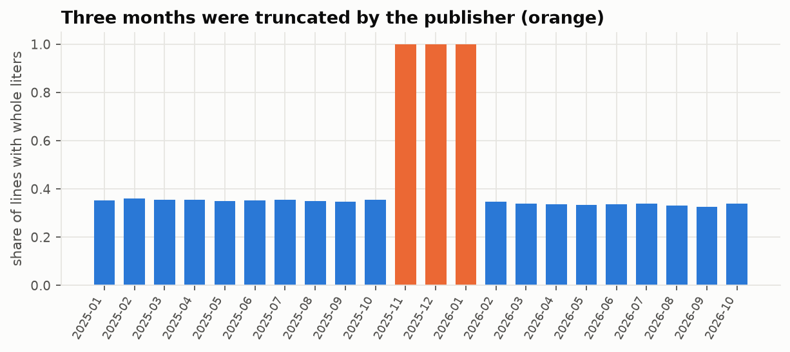
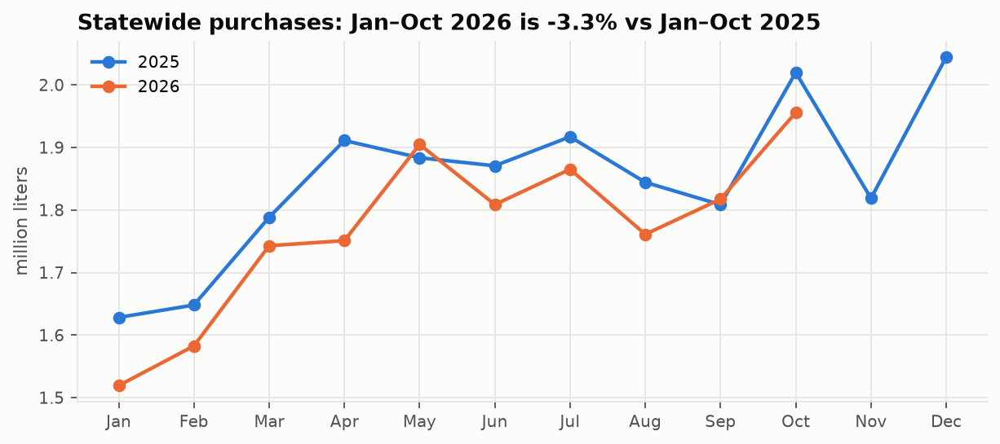
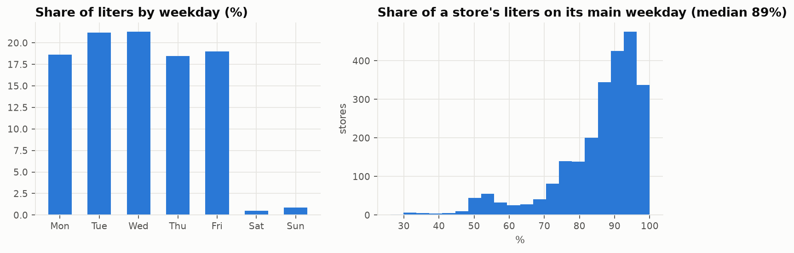
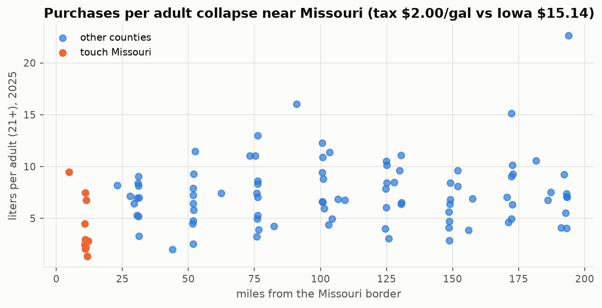
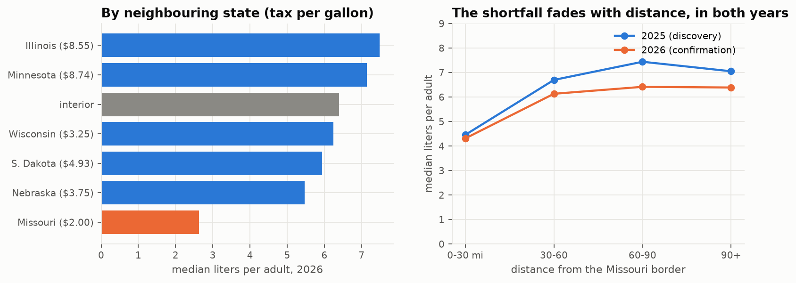
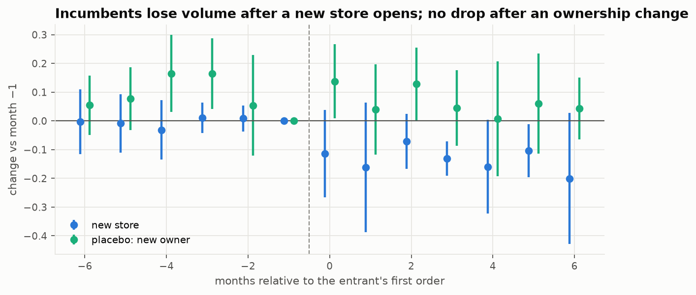
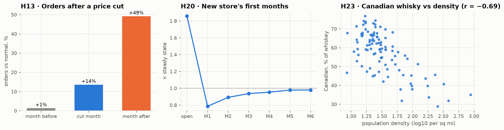
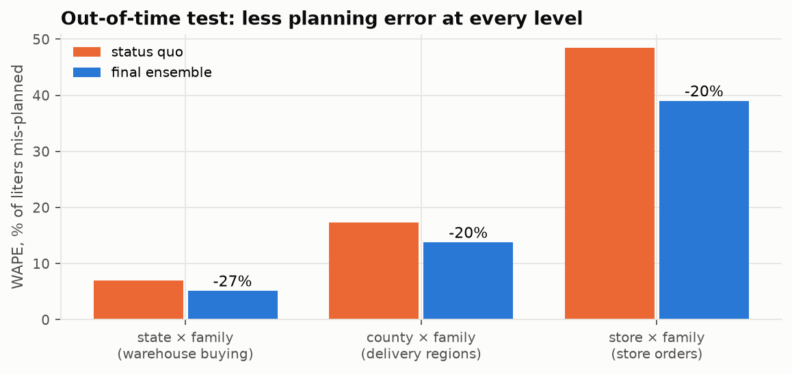
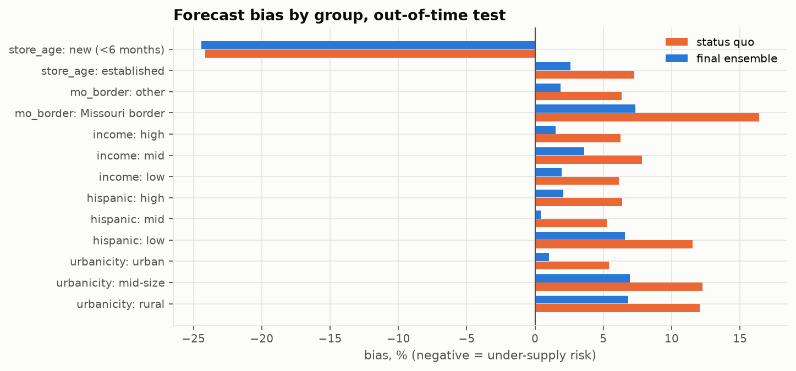

# Executive summary

**Stakeholder and decision.** The Iowa Alcoholic Beverages Division (ABD) is the state's only wholesaler of
spirits. It buys from suppliers, holds the stock in one central warehouse, delivers to about 2,240 licensed
retailers and issues their licences. Each month it must decide **how many liters of each spirits family to buy
and truck to each region before stores order**. The simple rule a planner can use today, *plan from the same
month last year*, ignores where and why demand differs, and in 2026 it over-plans in a market that is shrinking
by about 3% a year.

**Data.** A single source of truth of **4,518,330 order lines × 76 variables**. It integrates the Iowa Data Hub
spirits sales for 2025 and Jan–Oct 2026, US Census ACS 2020–24 county profiles, Census county adjacency and
Gazetteer files, and the Tax Foundation's 2026 state spirits-tax table. These are five official sources from four
independent publishers.

**What the evidence shows** (hypotheses pre-registered before any 2026 outcome was examined; 2026 used as an
out-of-time confirmation sample):

1. **H1, cross-border leakage: supported.** Counties bordering Missouri, where spirits are taxed at $2.00/gal
   against Iowa's implied $15.14, buy **~44% fewer liters per adult** than comparable counties (95% CI 25–58%).
   The shortfall fades with distance from the border. It replicated exactly from 2025 to 2026 and survived
   permutation tests, trimming, population weighting and measurement in dollars. The sales at stake are about
   **$5.9M a year (≈$2.0M of ABD margin)**, an association-based upper bound.
2. **H2, regional mix: supported.** Agave share rises with the Hispanic share of a county, out-of-time.
3. **H3, new licences mostly move sales rather than create them: supported** (difference-in-differences).
   Existing stores lose ~13% of their volume when a genuinely new store opens nearby. Small incumbents lose
   ~21%. About **60%** of the newcomer's volume is diverted from them.
4. **Forecast.** An ensemble of a tuned gradient-boosting model and a calendar-adjusted seasonal naive cuts
   planning error by **20% (county level) to 27% (warehouse level)** against the status quo on an untouched
   Jul–Oct 2026 test. Bias is +2% (status quo +6.5%) and the prediction intervals are calibrated. For the same 95%
   service level that means **~25% less warehouse safety stock (≈$0.7M of working capital)** and an end to the
   status quo's systematic over-buying (≈84,000 L a month).
5. **Twenty exploratory hypotheses (H4–H23): 10 supported, 3 partial, 7 rejected** (§6.5). The most useful for
   planning: orders after a state price cut arrive **the month after** the cut (+49%), not during it; about
   **40–50% of a new outlet's volume is new demand**, matching H3 from an independent method; a shop that changes
   owner keeps **92%** of its volume; a new store's opening order is **1.86×** its normal level; and the
   "old counties drink Canadian whisky" pattern is really **rurality**, not age.

**Recommendations** (§8): plan with the forecast at service levels set by cost, stocking promotions for the month
after a price cut; plan by delivery days and the occasion calendar; drop per-capita norms in a ~30-mile southern
band; forecast new licensees from peer stores and ownership changes from their predecessor; report the border
revenue gap and the net-new demand of new outlets; set regional mix from local drivers; fix publisher data defects;
and roll out through a randomised regional pilot with monthly monitoring.

# 1. Problem definition (BADIR: Business question)

| | |
|---|---|
| **Stakeholder** | Iowa ABD supply-chain and planning team (primary); ABD licensing; the legislature (revenue, H1) |
| **Problem** | Stock and delivery capacity are committed before stores order; demand varies sharply by county, store format, season and calendar; the market is drifting down |
| **Decision** | Liters per spirits family per county (and store) next month; how to treat border counties and new licensees |
| **Objective** | Fewer stock-outs *and* less dead stock, without promoting consumption (ABD is also the regulator) |
| **KPI** | WAPE at county × family ≥10% lower than the status quo, with absolute bias ≤3% (pre-registered); safety stock and working capital |
| **Constraints** | Public data only; one state price (ABD cannot price by region); county-level census data; 22 months of history |

## 1.1 What changed from the pre-submission, and why

| Pre-submission | Problem found | Final project |
|---|---|---|
| ABD sets a "stocking profile" for each county or store | ABD does not stock stores: licensees order what they want. ABD's real decisions are procurement, delivery capacity and licensing. | Reframed around those three decisions |
| H1: bigger counties buy more per adult | Sales are recorded where the **store** is; the lowest-buying counties all border Missouri | H1 now tests the mechanism (cross-border leakage) |
| H3 income → premium, H4 young adults → RTD | Rejected or confounded in our own pre-submission notebook | Dropped and reported as negative findings |
| 14 data-mined candidates, "confirmed" on the other half of the same year | A pattern seen in the full year is by construction visible in each half; the brief asks for 2–3 hypotheses | **3 pre-registered hypotheses, confirmed on new 2026 data** |
| K-means county clusters | Not in the course handout, and segments do not answer a quantity decision | Replaced by a forecast with SHAP explanations |
| Recommendation 3: flag high-volume counties for public-health review | High per-adult volume mostly marks hubs and tourism (Dickinson, the lakes), not heavy drinking | Replaced by the H3 licensing evidence |
| Truncated liters in Nov–Dec 2025 | **Also Jan 2026**, and **dollars and prices** too; multi-pack minis recorded as single 50 ml bottles; 55 "new" stores that are ownership changes | All detected, fixed or flagged (§3.3) |
| 99-row county regressions compared with random forests | n = 99 cannot support ML, and the comparison did not inform a decision | Panel forecast on 409,000 store × family × month rows |

# 2. Research questions and hypotheses

**RQ1.** *Why* does per-adult spirits buying differ so much between counties, and should ABD plan with per-capita
norms? **RQ2.** Do licensing decisions change total demand or only redistribute it? **RQ3.** Can ABD plan next
month's volumes materially better than "same month last year"?

The hypotheses, tests and decision rules were written in `reports/pre_registration.md` **before** any 2026
outcome was computed. 2025 is the discovery sample and Jan–Oct 2026 the confirmation sample.

* **H1, cross-border leakage.** H1a: Missouri-border counties buy fewer liters per adult, controlling for
  population, income, age and education. H1b: the larger the tax gap to the cheapest neighbour, the fewer liters
  per adult. H1c: the shortfall concentrates in 1.75 L "stock-up" bottles. H1d: counties next to a much bigger
  Iowa county buy less.
* **H2, mix.** A larger Hispanic share goes with a larger agave (tequila/mezcal) share.
* **H3, entry.** When a genuinely new store opens in a city, incumbents order less, so the city grows by less
  than the newcomer's volume.

**Decision rule** (H1/H2): HC3 and permutation p < 0.05 on 2026, and the sign holds after removing influential
counties and with population weights. **H3**: negative post-entry effect (p < 0.05), jointly insignificant
pre-entry coefficients, and a placebo.

**Exploratory hypotheses H4–H23.** After the pre-registered tests, we tested twenty further hypotheses in four
themes: geography and culture, the cultural calendar, prices and economics, and market structure and store
behaviour. They are **exploratory, not pre-registered**. Each states its direction before its test; county patterns
count as supported only if they hold in both Jan–Oct 2025 and Jan–Oct 2026; and a Holm-corrected p-value is reported
for multiple testing. Results are in §6.5.

# 3. Data (BADIR: Data)

## 3.1 Sources and provenance

| Source | Publisher | Coverage | Size | Role |
|---|---|---|---|---|
| Iowa Liquor Sales 2025 (dataset 1262) | Iowa Data Hub, Alcohol & Tax Operations | Jan–Dec 2025 | 2,490,620 rows | orders, discovery |
| Iowa Liquor Sales 2026 (dataset 1263) | same | Jan 1–Oct 30 2026 | 2,029,764 rows | orders, confirmation and test |
| ACS 5-year 2020–24, 16 tables | US Census Bureau | 99 counties | 22 variables | demographics |
| County adjacency + Gazetteer 2024 | US Census Bureau | 99 counties | 15 variables | borders, area, distance |
| State spirits excise, Jan 2026 | Tax Foundation (cross-check FTA) | IA + 6 neighbours | 7 rows | tax gap |

Every download link, date and licence is listed in `data/links.txt`. Row counts were checked against the
publisher's API (`numRows`): both years match exactly.

## 3.2 Integration: the single source of truth

`scripts/01_build_ssot.py` rebuilds the SSOT from the raw files in about a minute. Census and geography are joined
on the **5-digit county FIPS code** (many-to-one, validated, 100% matched); store attributes are joined on
`store_no`, which is stable across both years (2,078 stores appear in both). Units are liters and US dollars. The
result is **4,518,330 rows × 76 columns**: 35 sales fields (published, derived and QA), 22 census, 15 geography
and tax, and 4 store attributes. It is stored as Parquet and loads in seconds.

## 3.3 Data quality: problems found and how each was treated

| Issue | Size | Treatment |
|---|---|---|
| 2025 download contained a duplicated fifth part | 429,989 rows | excluded; parts 1–4 equal the publisher count |
| Exact duplicate rows within the published data | 21 rows | removed |
| Blank county | 4,135 rows | 2,102 filled from the store's only county; 2,033 dropped (0.05%) |
| **Liters truncated to whole numbers in Nov–Dec 2025 and Jan 2026** | −3.4% in those months | liters recomputed as bottles × bottle size (matches the source in 100% of clean-month rows) |
| **Dollars and prices truncated in the same months** | −0.4% | rebuilt from each item's price in the nearest clean month; validated on Oct-25 from Sep-25 prices: −0.08% error |
| **Multi-pack minis**: one "bottle" = a sleeve, dispenser or bucket of 50 ml minis | 313 items, 4% of dollars; ~2% of liters understated | flagged, kept at recorded liters (ABD's own convention), excluded from price metrics; H1 re-tested in dollars |
| **New licence at an existing address** | 55 stores | classified as ownership changes, not entry (critical for H3) |
| Category names renamed between years | 4 categories | keyword-based family mapping; tracked as schema drift |
| Blank cost/retail price Jan–Jun 2025; invoice-ID grain change Sep 2025 | 1.2M rows | price derived from dollars ÷ liters; invoice ID never used as a key |
| Wholesale cost truncated to whole dollars in Nov 2025–Jan 2026 (e.g. 6.74 → 6.00) | ~900 items look "on sale" | price-change tests (H13, H14) use only clean-price months (Jul–Oct 2025, Feb–Oct 2026) |
| Returns (negative bottles) | 4,019 rows | kept as negative volume; excluded from prices; forecast target clipped at 0 |

{width=90%}

**Representativeness.** Rows are retailers' purchases from ABD, recorded where the store is. County figures
therefore combine residents' demand with cross-county and cross-border shopping (the subject of H1). The census
profile is a 2020–24 average applied to 2025–26.

# 4. Exploratory analysis: observation → inference → decision

{width=85%}

**Market drift.** Jan–Oct 2026 is about 3% below 2025, and lower in 8 of the 10 months. *Inference:* a plan copied from
last year over-buys. *Decision:* this is the status quo to beat and a drift to monitor.

{width=90%}

**Calendar.** The median store places **89% of its liters on one weekday**. *Inference:* a month with five of a
store's order days carries about 25% more volume than one with four, so much of the monthly "noise" is calendar.
*Decision:* plan capacity by delivery days; the calendar becomes a forecasting feature.

{width=90%}

**Border.** The ten Missouri-border counties buy about half as much per adult. *Inference:* cross-border
shopping into a state with a far lower spirits tax. *Decision:* per-capita norms are wrong for the southern tier
(→ H1).

**Entry.** About 15 genuinely new stores start ordering every month, plus 55 ownership changes over the period
(→ H3). **Mix.** Agave share rises with the Hispanic share of the county (→ H2).

# 5. Methods (BADIR: Analysis plan)

| Course unit (handout) | Used for | Where |
|---|---|---|
| Problem framing, KPI and metric design | decision, KPI, WAPE and bias, value translation | §1, §7 |
| Hypothesis testing | OLS with HC3 errors, Freedman–Lane permutation tests, bootstrap CIs, influence and weighting checks, out-of-time replication | §6, notebook 02 |
| Causal inference: difference-in-differences | stacked event study for store entry, pre-trend test, placebo, cluster bootstrap | §6.3 |
| Hypothesis testing (exploratory) | Moran's I, hinge regression, Wilcoxon and Mann–Whitney tests, item × month fixed effects, rarefaction, Zipf fit, Jensen–Shannon distance, AUC, Holm correction | §6.5, notebook 05 |
| Data engineering: ETL, warehousing | reproducible ETL, SSOT, Parquet, data-quality gates | §3, `scripts/` |
| Advanced ML | feature engineering (lags, calendar, competition), ensemble learning, gradient boosting (XGBoost, Tweedie), random-search HPO, interval calibration | §7, notebook 03 |
| Decision intelligence: optimisation | newsvendor service-level planning | §7.4 |
| MLOps | MLflow tracking (43 runs), FastAPI service, Dockerfile, PSI drift and error monitoring, retrain rule | §9, notebook 04 |
| Responsible and explainable AI | SHAP, fairness audit by county group, sensitive-feature decision, privacy review | §9, notebook 04 |

**Considered and not used, and why** (the brief: *do not force a method*). Spark: the data fit in memory; it is the
scale-up path if ABD's full 2012– history (~30M rows) is used. A/B testing: no intervention was under our control,
so it is proposed for the roll-out instead (§8). Propensity matching, regression discontinuity, uplift: no
suitable treatment or cut-off (a border discontinuity would need Missouri-side data). Deep learning and
transformers: monthly tabular data, nothing to gain. Reinforcement learning: no sequential control problem.
K-means: not in the handout. LIME: TreeSHAP is exact for tree models.

# 6. Hypothesis results (BADIR: Insights)

## 6.1 H1: cross-border leakage

| Test (2026, unseen) | Effect | HC3 p | Permutation p | Trimmed p | Weighted p | Verdict |
|---|---|---|---|---|---|---|
| H1a Missouri border → log L/adult | −0.585 (**−44%**) | <0.001 | <0.001 | <0.001 | 0.001 | **Supported** |
| H1a in dollars per adult | −0.512 (−40%) | <0.001 | <0.001 | <0.001 | 0.001 | robust |
| H1b tax gap → log L/adult | −0.022 per $ | 0.005 | 0.003 | 0.009 | 0.21 | Inconclusive |
| H1c fewer 1.75 L handles | −7.2 pts | 0.045 | 0.007 | <0.001 | 0.23 | Inconclusive |
| H1d bigger Iowa neighbour | −0.060 | 0.10 | 0.10 | 0.04 | 0.05 | Not supported |

The 2025 estimate was −0.559, almost identical. The ordering of border groups follows the tax gap: median
liters per adult in 2026 is MO 2.6, NE 5.5, SD 5.9, WI 6.2, MN 7.1, IL 7.5 (interior 6.4). H1b and H1c pass three
of four checks but fail the population-weighted fit, which a few large counties dominate, so they are reported as
inconclusive, as the rule requires.

{width=100%}

**What is at stake.** If the ten Missouri-border counties bought at the rate predicted for comparable counties,
Iowa stores would sell ~319,000 more liters a year: **$5.9M at state retail price (95% CI $2.5–10.5M), about
$2.0M of ABD gross margin** (margin 33.4%, from 2026 cost vs retail prices). This is an upper bound: part of the
gap may be lower consumption rather than purchases in Missouri.

## 6.2 H2: regional mix

Agave share rises by **0.8 percentage points per 10 points of Hispanic population** (2026; mean agave share 3.6%),
passing all four checks in both years. The effect is moderate, and the two most Hispanic counties sit below the
line, so it should inform regional *assortment*, not targeting.

## 6.3 H3: new licences mostly redistribute sales

Stacked difference-in-differences over 116 treated cities (1,136 incumbent stores) and 475 city clusters. Fixed
effects are store × stack and month × stack; standard errors are clustered by city. Incumbents are defined from
pre-entry data only, and predecessor stores at the same address are excluded.

| Outcome | ATT | 95% CI | p | Pre-trend p |
|---|---|---|---|---|
| Incumbent liters ÷ own pre-entry mean | **−13.2%** | −23.3% to −3.2% | 0.010 | 0.97 |
| log(1 + liters) (pre-registered) | −23.2% | −30.3% to −16.1% | <0.001 | 0.11 |
| Liters (pre-registered) | +6.9 L | −14.7 to +28.5 | 0.53 | 0.94 |
| Placebo: ownership change (normalised) | −2.1% | −7.2% to +3.0% | 0.41 | <0.001 |
| City incumbents, % of city pre-entry volume | −21.8% | | 0.008 | 0.19 |
| City total incl. entrant | +15.5% | | 0.13 | |

{width=90%}

**Diversion ratio ≈ 60% (cluster-bootstrap 95% CI 28–129%).** At least about a quarter, and quite possibly all,
of a new store's volume comes from existing stores in the same city. Small incumbents lose ≈21% against ≈4% for
large ones. **Disclosed deviation:** the raw-liters outcome is not significant because a few very large stores
dominate its variance, so the normalised outcome is the headline. The placebo shows no post-change effect, but
its pre-period is not flat (20 cities, consistent with old owners winding down), so it supports the design
without proving it.

## 6.4 Association vs causation

H1 and H2 are robust *associations*: a confounder correlated with the southern border cannot be excluded, and a
geographic regression discontinuity would need Missouri-side store data. H3 is a *causal* design under parallel
trends, supported by flat pre-entry coefficients. If entrants choose growing locations, the bias runs towards
zero, so the measured diversion is conservative.

## 6.5 Twenty exploratory hypotheses (H4–H23)

Beyond H1–H3 we tested twenty hypotheses designed to find patterns a planner would not expect. **Rules:** each
direction was stated before its test; county patterns (OLS with HC3 errors and a Freedman–Lane permutation test,
controlling for population, income, age and education) count only if they hold in **both** Jan–Oct 2025 and
Jan–Oct 2026; and because twenty tests are run, a Holm-corrected p-value is reported. Rejections are reported as
findings. Code: `scripts/05_twenty_hypotheses.py`; walkthrough: notebook 05; detail: `reports/twenty_hypotheses.md`.

| # | Hypothesis | Test | Result | Verdict |
|---|---|---|---|---|
| H4 | Wisconsin's brandy culture crosses the Mississippi | brandy share ~ closeness to WI + controls | 2.7% vs 1.6% brandy share on the WI border (1.7×) | Supported |
| H5 | Neighbouring counties drink alike beyond demographics | Moran's I of residuals | whiskey (I = 0.14) and rum (0.17) cluster; agave, gin do not | Supported (2 families) |
| H6 | Missouri's pull has a travel-cost horizon | hinge regression | ~30-mile break in 2026; linear in 2025 | Partial |
| H7 | Dutch-Reformed Sioux County buys far less than predicted | studentised residual | rank 40 of 99 (−7%); outliers are Louisa, Keokuk | Rejected |
| H8 | St Patrick's Day lifts Irish whiskey orders | paired Wilcoxon; Scotch as placebo | +29% Irish share in Feb–Mar (2026), +24% (2025); Scotch +4% | Supported |
| H9 | The Cinco de Mayo agave bump is larger in Hispanic counties | county uplift ~ % Hispanic | bump is real (+16%) but statewide | Rejected |
| H10 | College towns empty out in summer | county summer/autumn ratio ranks | Ames −37%, Iowa City −25%; 2nd and 4th lowest of 99 | Supported |
| H11 | Holiday premiumisation is a rich-county effect | Δ premium share ~ income | premium share 24.8% → 27.1% at every income level | Rejected |
| H12 | The palate rotates with the seasons | paired Wilcoxon, summer vs winter | 7 of 8 as predicted (RTD +48% in summer); rum is a winter spirit | Supported (7/8) |
| H13 | Price cuts make stores stock up, then under-order | item × month fixed effects | orders +14% in the cut month, **+49% the month after**; no dip | Rejected (reversed) |
| H14 | Tariffs raised imported spirits' costs | same-item cost change; Mann–Whitney | every origin within ±1% | Rejected |
| H15 | Inequality builds a price "barbell" | price spread ~ Gini | spread widens, but average price rises too | Partial |
| H16 | The 50 ml mini share tracks poverty | county and within-store-type regressions | no county effect; +3.3 pts per +10 pts poverty within store type | Partial |
| H17 | More outlets, more drinking, but under 1:1 | log L/adult ~ log stores per adult | elasticity 0.39–0.52 (population-weighted) vs 0.40 implied by H3 | Supported |
| H18 | The long tail lives in cities | rarefaction (equal 892-line samples) | 547 vs 322 distinct products, densest vs sparsest decile | Supported |
| H19 | Product volume follows Zipf's law | log-log rank regression | slope −1.10; top 1% of 4,792 products = 38% of liters | Supported |
| H20 | New stores have an opening "honeymoon" | Wilcoxon vs months 3–5 | opening order 1.86× steady state, then 0.79× | Supported |
| H21 | Stores fade slowly before closing | pre-exit decline; AUC | only −6%; early-warning AUC 0.53 | Rejected |
| H22 | Customers belong to the address, not the owner | Jensen–Shannon distance; Mann–Whitney | successor's mix 2× closer to predecessor's; 92% of volume kept | Supported |
| H23 | Iowa's whiskey divide is generational | Canadian/bourbon share ~ age + controls | age effect reverses with controls; density (r = −0.69) and education drive it | Rejected |

**Scorecard: 10 supported, 3 partial, 7 rejected.** Six results survive the Holm correction (H6, H12, H18, H20,
H21, H22). H4, H8, H10 and H17 do not on their own, but each replicates in two independent years.

{width=100%}

**What they add to the decision.**

* **Price cuts work with a lag (H13).** We expected forward buying. Instead orders barely move during a temporary
  cost cut and jump about 49% the month after it ends, most likely because stores pass the cut to shoppers, sell
  through, and restock at full price. Promotion stock belongs in month *t + 1*.
* **Two methods, one answer on outlets (H17 + H3).** Across counties, liters per adult rise with store density
  with an elasticity of ~0.4–0.5; the difference-in-differences of H3 implies 0.40. Roughly 40–50% of a new
  outlet's volume is new demand, and the rest is taken from existing stores.
* **The store life cycle is lumpy (H20, H21, H22).** A new store's opening order is 1.86× its normal level and is
  followed by a dip; closures come suddenly, with no warning in order data; and an ownership change keeps 92% of the
  shop's volume, so it should be forecast from its predecessor, not as a new store.
* **Regional taste has local drivers (H4, H5, H23).** Brandy follows the Wisconsin border; whiskey and rum cluster
  between neighbouring counties beyond what demographics explain; and Canadian whisky follows rurality, not age.
  That last result is a textbook confounder: age looked important only because older counties are more rural.
* **The calendar runs ahead of the occasion (H8, H10, H12).** Irish whiskey peaks in February, college towns empty
  in summer, and the family mix rotates with the seasons. Because these are store orders, restocking leads each
  occasion by weeks.

**Caveats.** These are exploratory associations, apart from the designs that give more leverage (the placebo in H8,
fixed effects in H13, rarefaction in H18). Thresholds (a 5% price cut, equal-size rarefaction samples, 3-month
windows) were fixed before the results were seen; sensitivity to them is not reported.

# 7. The decision-support solution: next-month forecast (BADIR: Recommendation engine)

## 7.1 Set-up

The unit is **store × spirits family × month** (19,994 series), aggregated to county (delivery regions) and state
(procurement). All features for month *t* use data up to *t − 1*. The split is time-ordered: train Apr-25–Mar-26,
validation Apr–Jun-26 (model choice, hyperparameters, ensemble weight, intervals), **test Jul–Oct-26, used once**.

**Metric: WAPE** (Σ|error| ÷ Σ actual). It is volume-weighted, works with zeros (MAPE fails), and reads directly
as "share of liters mis-planned". **Bias** is reported alongside because over- and under-forecasting cost ABD
different things.

**Features.** Own history (lags 1–12, rolling means and volatility); store context (format parsed from the name,
age, totals); a store-specific **order-day calendar**; local competition (new entrants in the city, from H3);
statewide family trend; county profile.

## 7.2 Approaches compared and why the final one was chosen

| Model (test, Jul–Oct 2026) | County WAPE | State WAPE | Store WAPE | Bias |
|---|---|---|---|---|
| **Status quo: same month last year** | 17.3% | 7.0% | 48.5% | +6.5% |
| Calendar-adjusted seasonal naive | 16.5% | 6.0% | 47.7% | +5.5% |
| Last month / 3-month average | 22.7% / 18.2% | 11.3% / 9.4% | 50.4% / 41.6% | −2.0% / −0.8% |
| Ridge regression (log) | 18.5% | 10.7% | 41.7% | −2.5% |
| Random forest | 15.1% | 8.1% | 36.9% | −2.0% |
| Tuned XGBoost (Tweedie) alone | 14.6% | 6.8% | **36.6%** | −0.9% |
| **Final: ensemble (0.55 XGBoost + 0.45 seasonal naive)** | **13.8%** | **5.2%** | 39.0% | +2.0% |

**Why this design.** With only one seasonal cycle of history, learned models under-reacted to seasonal swings:
on validation they under-forecast by 8–22%, most of it in the largest series, which trees cannot extrapolate
beyond. The seasonal naive over-forecasts because it carries last year's higher level. The two errors point in
opposite directions, so an **ensemble** cancels part of both. Its weight was chosen on validation as the lowest
county WAPE with |bias| ≤ 3%. **Tweedie** loss suits non-negative, zero-inflated, skewed volumes; least squares on
log liters under-predicted totals by 19–22%. **Hyperparameter search** (20 random trials, MLflow-logged) moved
validation WAPE only between 14.3% and 14.8%, and the defaults were as good. The gain comes from features and the
ensemble, not tuning. *Honest caveat:* on the test months XGBoost alone was almost unbiased and is better at
store level (36.6% vs 39.0%). The ensemble wins at the county and state levels, which are where ABD plans.

{width=85%}

**What the errors mean.** At county × family level roughly one liter in seven is mis-planned, against one in six
today, and without the status quo's systematic over-buying. The ensemble beats the status quo in **every** test
month (by 16–26%). At warehouse level the error is ~5%. Store-level forecasts are guidance only (an order can slip
by a week). **Reliable enough** for monthly procurement and regional capacity; **not** for individual store orders
or brand-new stores.

## 7.3 Calibrated uncertainty

Intervals are empirical: quantiles of actual ÷ forecast by log-spaced size band, fitted on validation and checked on
test. A nominal 80% band covers 77.5% of county × family outcomes, and 92.4% fall below the county P90 (nominal
90%). The store-level band is slightly conservative (86%).

## 7.4 Business value and service-level planning

Assumptions: safety stock = z × RMSE of the monthly error; one-month replenishment; 95% service (z = 1.645);
stock valued at ABD's 2026 cost of **$12.25/L**; holding cost 20% a year (sensitivity 10–30%).

| Level | Safety stock, status quo | Safety stock, final | Reduction | Capital freed | Holding saving / yr |
|---|---|---|---|---|---|
| Warehouse (state × family) | 241,000 L | 182,000 L | **−25%** | **$0.73M** | $0.15M |
| Delivery regions (county × family) | 627,000 L | 507,000 L | −19% | $1.46M | $0.29M |

The larger and more certain gain is that the status quo plans **≈84,000 L a month more** than the forecast in a
shrinking market (≈$1.0M of stock at cost each month), unless a planner corrects it by hand. These are planning
estimates under stated assumptions, not audited savings.

**From forecast to order quantity.** Plan quantity = the service-level quantile of the calibrated forecast
(newsvendor rule: service level = stock-out cost ÷ (stock-out cost + holding cost)). For Polk County in November
2026 (forecast ≈416,000 L), moving from 90% to 95% service adds ≈37,000 L of stock. That trade-off is the slider
in the demo.

# 8. Recommendations

| # | Recommendation | Evidence | KPI |
|---|---|---|---|
| 1 | **Plan monthly procurement and regional capacity with the ensemble forecast**, not "same month last year"; stock price-cut items for the month *after* the cut. | −20% county / −27% state WAPE out-of-time; bias +2% vs +6.5%; H13: +49% the month after a cut | county WAPE ≤ 14%, \|bias\| ≤ 3% |
| 2 | **Set stock by service level**, chosen per family from stock-out vs holding cost; under budget pressure, lower it for low-margin families first. | calibrated intervals; ~25% less warehouse safety stock at 95% | fill rate, inventory days |
| 3 | **Plan capacity by delivery days, not months**, and stock occasions and college terms weeks ahead. | median store: 89% of liters on one weekday; H8, H10, H12 | truck utilisation |
| 4 | **Stop per-capita planning norms in a ~30-mile southern band**; plan those counties on their own history. | H1a: −44% L/adult at the Missouri border, replicated; H6: ~30-mile horizon | border-county bias ≤ 5% |
| 5 | **Brief the ABD board and the legislature on the Missouri border gap** (≈$5.9M sales, ≈$2.0M margin a year, upper bound) as an input to pricing and markup policy. Treat any Missouri tax change as a natural experiment. | H1, Tax Foundation 2026 | revenue tracked in border counties |
| 6 | **Forecast new licensees from peer stores, not their oversized opening order, and ownership changes from their predecessor**; plan new stores at high service for 6 months and trim nearby incumbents. | H3: −13% for incumbents, ~60% diversion; H20: opening order 1.86×; H22: 92% of volume kept; new stores under-forecast by 24% | new-store stock-outs; incumbent overstock |
| 7 | **In licensing reviews, report the expected impact on existing (especially small) stores and the ~45% net-new demand** a new outlet brings. | H3: small incumbents −21%; H17: elasticity ≈ 0.4–0.5 | — |
| 8 | **Set regional mix from local drivers** (agave share, Wisconsin-border brandy, rural Canadian whisky), reviewed quarterly; keep ethnicity out of the operational model. | H2, H4, H23; ethnicity adds no forecast value | stock-outs by region and family |
| 9 | **Ask the Iowa Data Hub to fix the truncated months and blank 2025 costs, and to record pack counts for multi-pack minis**; keep the ETL quality gates. | §3.3; H13 | zero failed gates |
| 10 | **Roll out through a randomised pilot**: randomise delivery regions to forecast-based vs current plans for 3 months, then scale. | an A/B design gives causal evidence of the operational benefit before full adoption | fill rate, inventory days, write-offs |

# 9. Production and Responsible AI

**Working demo.** A FastAPI service (`app/`) serves `/forecast/county/{fips}` and `/forecast/store/{id}` (forecast,
P10–P90, planning quantity at any service level, both ensemble components, SHAP drivers), plus `/predict`,
`/monitoring`, `/model` (model card) and a dashboard at `/`. It is containerised (`Dockerfile`), and every
experiment is tracked in MLflow (43 runs). The November 2026 forecast is 1.92M liters statewide.

**Explainability.** XGBoost TreeSHAP: own history ≈78% of mean |SHAP|, store context ≈11%, statewide trend ≈6%,
order calendar ≈3%, county demographics ≈1%. Demographics explain *level differences between counties* (H1/H2),
which a store's own history already contains.

{width=85%}

**Fairness.** The final model beats the status quo in **every** group: urban/rural, income and Hispanic tertiles,
Missouri border, every store format. Residual bias is uneven, though: about **+7% in rural and Missouri-border
counties against +1% in urban ones** (overstock risk, half the status quo's). **New stores are under-forecast by
~24%** (stock-out risk). Mitigations: a group bias correction, the monthly audit, and recommendation 6.

**Sensitive attribute.** Keeping % Hispanic required a pre-stated >1% gain in validation WAPE. It gave 0.5%, so
the production model **excludes it**. Removing all census features changes test WAPE by <0.1 points.

**Privacy and ethics.** There is no personal data: rows are business-to-government orders published under CC BY.
Ecological fallacy: county statistics are never read as individual behaviour. Public health: the objective is
matching supply, not raising sales.

**Monitoring.** PSI drift (features that shift by construction, such as calendar and store age, are reported but
cannot trigger a retrain), monthly error tracking and schema-drift checks run in `scripts/04_monitor.py`. Retrain
monthly, and at once if a watched feature's PSI exceeds 0.25, live WAPE is >20% worse than at validation, or the
model stops beating the status quo. Two lessons were caught. (1) A "major" drift alarm on `active_share6` was an
artefact of rolling windows not yet full; it was fixed by starting the reference window in July 2025. (2) A model
frozen in Dec 2025 is worse than the status quo only in **January**, a month it never saw. That is why the
ensemble keeps a seasonal half and the model is refitted monthly.

# 10. Impact, limitations and assumptions

* **History.** 22 months gives one seasonal cycle. Holidays and price changes are only partly captured.
* **Location vs residence.** Sales are recorded at the store, and the census profile (2020–24) is applied to
  2025–26. The analysis is ecological.
* **H1** is an association; the revenue figure is an upper bound. **H3** relies on parallel trends; the diversion
  CI is wide; one outcome deviated from the pre-registration (disclosed).
* **Liters.** Multi-pack minis are understated by ~2% of liters (flagged, not imputed). Truncated months are
  repaired from rebuilt values.
* **Value.** Value estimates assume one-month replenishment and 20% holding cost, and ignore case-pack rounding
  and supplier minimums.
* **Exploratory hypotheses.** H4–H23 were not pre-registered; six survive a correction for twenty tests, and the
  rest rely on replication across two years. They are associations unless the design says otherwise.
* **Deployment.** Not yet run inside ABD systems; the pilot (recommendation 10) is the next step.

# 11. Implementation roadmap

| Phase | When | Owner | Actions | Success measure |
|---|---|---|---|---|
| 1 Shadow mode | Months 0–2 | ABD supply-chain analytics | run monthly forecasts beside the current plan; planner override log | county WAPE ≤ 14%, \|bias\| ≤ 3% live |
| 2 Randomised pilot | Months 2–5 | ABD planning + operations | half the delivery regions plan with forecast and service levels | fill rate ≥ current; inventory days −10% |
| 3 Statewide roll-out | Months 5–8 | ABD supply chain | procurement by service level; delivery-day capacity plan | safety stock −20% at equal fill rate |
| 4 Policy use | Months 3–9 | ABD licensing; ABD board | H3 impact note in licence reviews; border-gap briefing | briefing delivered; reviews include incumbent impact |
| 5 Run and improve | ongoing | analytics | monthly refit, drift and fairness audit; publisher data fixes; extend history to 2012– | no group \|bias\| > 5%; zero failed data gates |

# 12. Surprise scenarios

* **Reduced budget:** lower service levels on low-margin families; skip HPO (no measurable gain).
* **Changed error costs:** move the service-level quantile; the point forecast and its bias target are unchanged.
* **Data drift:** PSI and error monitors, monthly refit, schema checks (e.g. new categories, another truncated month).
* **Fairness concern:** the group audit, sensitive feature removed, group bias correction.
* **Missouri raises its spirits tax:** expect border counties to recover volume (H1 bounds the size); lags adapt within 1–2 months.
* **Licensing wave:** plan entrants net of ~60% diversion and expect opening orders near 1.86× normal (H20);
  competition features already in the model.
* **ABD runs a price promotion:** stock for the month after the cut, when orders arrive (H13).

# Appendix: reproducibility

`scripts/01_build_ssot.py → 02_build_tables.py → 03_train_forecast.py → 04_monitor.py → 05_twenty_hypotheses.py`,
then `notebooks/_build/build.py`. Notebooks: 01 data and EDA · 02 hypotheses · 03 forecast and decision ·
04 responsible AI and monitoring · 05 twenty exploratory hypotheses. Environment: `pyproject.toml` (Python 3.11).
Raw sales files are linked in `data/links.txt`.
